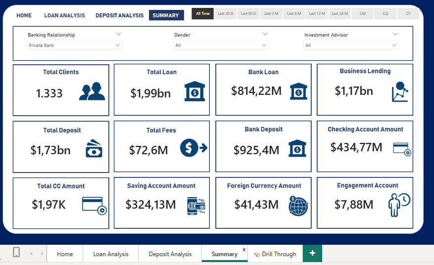
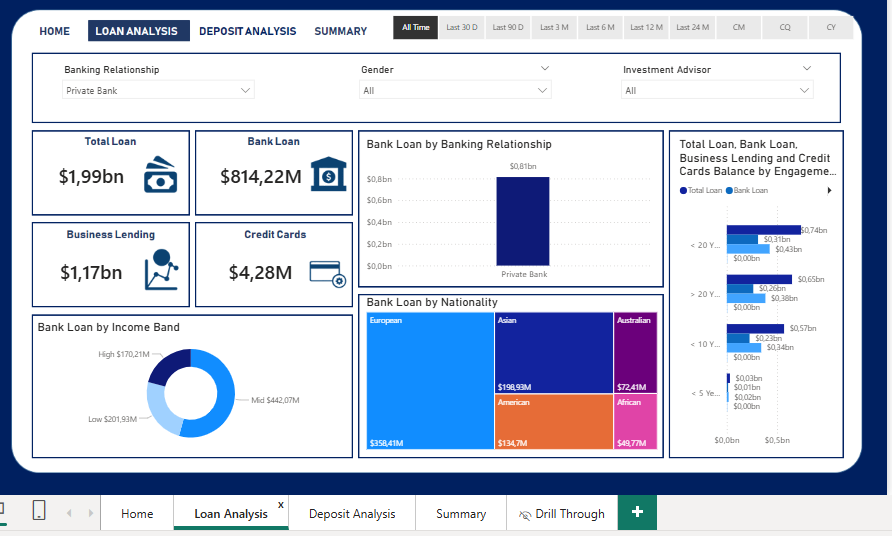
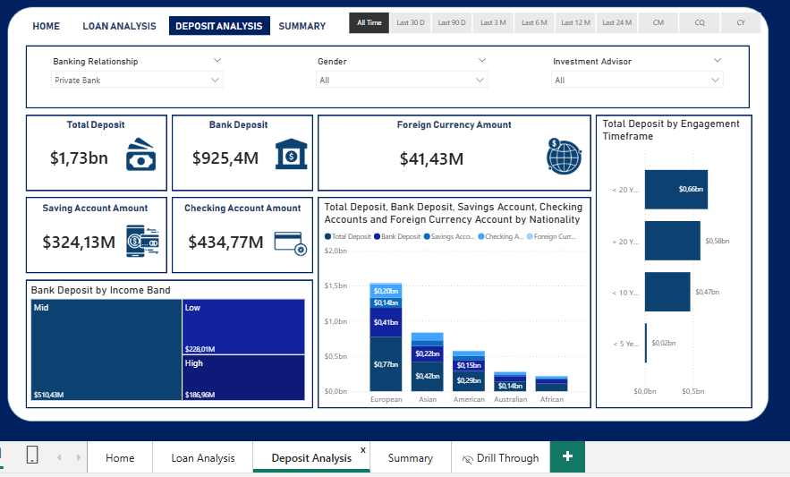
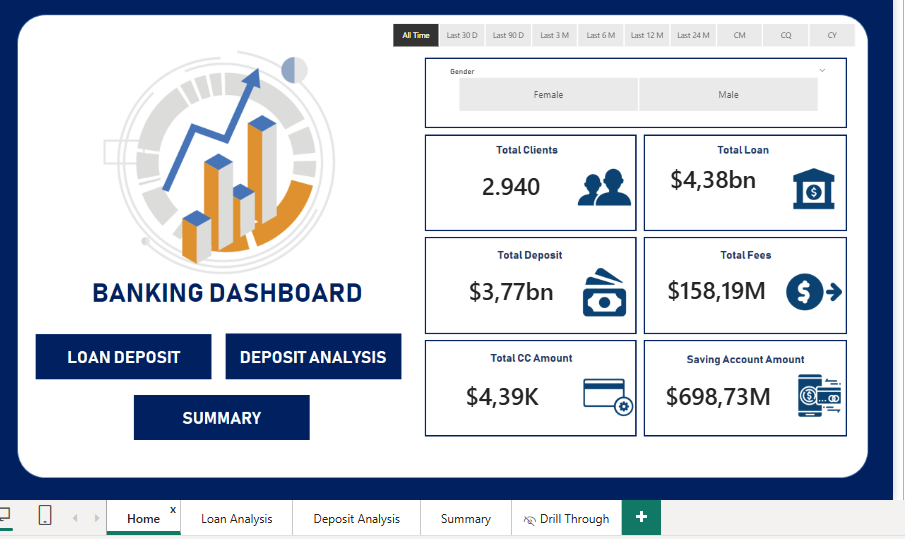
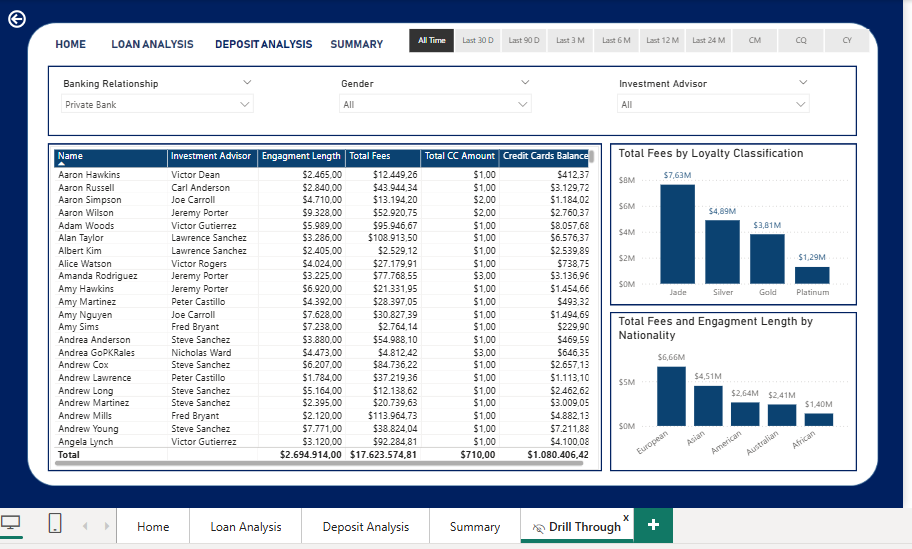

# Banking Domain Data Analysis











# Banking Dashboard Analysis — Power BI

## Project Overview

Proyek ini bertujuan untuk menganalisis data perbankan menggunakan **Microsoft Power BI** guna memahami karakteristik nasabah, kinerja portofolio pinjaman, simpanan, biaya perbankan, serta tingkat keterlibatan nasabah.

Melalui proses **Data Cleaning, Data Transformation, Data Modeling, DAX Measures**, dan **Data Visualization**, proyek ini menghasilkan dashboard interaktif yang membantu pengguna memahami kondisi bisnis perbankan berdasarkan berbagai indikator dan segmentasi nasabah.

Dashboard dirancang untuk mendukung proses **Business Intelligence**, **Exploratory Data Analysis (EDA)**, dan pengambilan keputusan berbasis data.

## Business Problem

Institusi perbankan perlu memahami hubungan antara karakteristik nasabah, aktivitas perbankan, portofolio pinjaman, simpanan, dan biaya layanan.

Tanpa analisis yang terstruktur, informasi tersebut dapat sulit dipahami secara menyeluruh. Oleh karena itu, diperlukan dashboard yang mampu menyajikan indikator utama secara terintegrasi dan memungkinkan pengguna melakukan analisis berdasarkan kategori nasabah.

Permasalahan bisnis yang menjadi fokus proyek ini meliputi:

- Memahami gambaran umum kinerja perbankan melalui berbagai Key Performance Indicators (KPIs).
- Menganalisis distribusi portofolio pinjaman dan simpanan.
- Mengidentifikasi perbedaan nilai pinjaman dan simpanan berdasarkan karakteristik nasabah.
- Menganalisis keterlibatan nasabah berdasarkan Engagement Timeframe dan Engagement Length.
- Memahami distribusi biaya perbankan berdasarkan Loyalty Classification dan Nationality.
- Menyediakan dashboard interaktif untuk mendukung eksplorasi data dan pengambilan keputusan.

## Project Objectives

Tujuan utama proyek ini adalah:

1. Mengolah dan menyiapkan data perbankan agar dapat digunakan untuk analisis.
2. Mengembangkan data model dan perhitungan menggunakan DAX.
3. Membuat dashboard interaktif menggunakan Microsoft Power BI.
4. Menganalisis portofolio pinjaman, simpanan, dan biaya perbankan.
5. Mengeksplorasi pola berdasarkan Income Band, Nationality, Banking Relationship, dan kategori keterlibatan nasabah.
6. Menyusun business insights dan rekomendasi berdasarkan hasil analisis yang tersedia.
7. Menunjukkan kemampuan teknis dan analitis yang relevan untuk peran Data Analyst.

## Tools & Technologies

- **Microsoft Power BI** — Dashboard Development dan Data Visualization.
- **Power Query** — Data Cleaning dan Data Transformation.
- **DAX (Data Analysis Expressions)** — Calculated Measures dan Business Calculations.
- **Data Modeling** — Pengorganisasian hubungan dan struktur data untuk analisis.
- **Exploratory Data Analysis (EDA)** — Eksplorasi pola dan distribusi data.
- **Business Intelligence (BI)** — Penyajian informasi untuk mendukung keputusan bisnis.
- **Data Visualization** — Penyajian metrik melalui visual interaktif.

## Dataset Overview

Dataset yang digunakan mencakup informasi terkait nasabah dan aktivitas perbankan.

Tabel yang digunakan dalam proyek ini meliputi:

- **Banking Relationship** — Informasi terkait hubungan nasabah dengan layanan perbankan.
- **Client-Banking** — Informasi nasabah dan metrik keuangan yang digunakan dalam analisis.
- **Gender** — Kategori gender nasabah.
- **Investment Advisor** — Informasi terkait Investment Advisor.
- **Period** — Informasi periode yang digunakan dalam data model.

Struktur tabel tersebut digunakan untuk mendukung analisis berdasarkan kategori nasabah, karakteristik keuangan, dan indikator kinerja perbankan.

## Data Cleaning & Transformation

Tahap Data Preparation dilakukan untuk menyiapkan data sebelum digunakan dalam dashboard.

Proses yang tercakup dalam proyek ini meliputi:

- Memeriksa struktur dan tipe data.
- Menyiapkan kolom yang dibutuhkan untuk analisis.
- Membuat kategori berdasarkan nilai numerik.
- Menyiapkan atribut terkait keterlibatan nasabah.
- Mengembangkan perhitungan yang dibutuhkan untuk analisis perbankan.

### 1. Engagement Timeframe

Kategori Engagement Timeframe digunakan untuk mengelompokkan nasabah berdasarkan durasi keterlibatan mereka dengan bank.

Pengelompokan ini membantu analisis terkait perbedaan nilai pinjaman dan simpanan pada setiap kategori keterlibatan.

### 2. Engagement Days

Kolom Engagement Days digunakan untuk menghitung durasi keterlibatan nasabah berdasarkan tanggal bergabung dengan bank dan tanggal saat analisis dilakukan.

```DAX
Engagement Days =
DATEDIFF(
    'Clients - Banking'[Joined Bank],
    TODAY(),
    DAY
)
```

### 3. Income Band

Income Band digunakan untuk mengelompokkan nasabah berdasarkan pendapatan.

Kategori yang digunakan dalam proyek ini:

- **Low Income** — Income kurang dari 100000.
- **Mid Income** — Income kurang dari 300000 sesuai batas kategori yang digunakan dalam implementasi proyek.

Income Band digunakan untuk mendukung analisis perbedaan nilai pinjaman dan simpanan berdasarkan kategori pendapatan.

### 4. Processing Fees

Processing Fees digunakan untuk menghitung biaya pemrosesan berdasarkan aturan yang diterapkan dalam proyek.

Kategori **High Processing Fees** menggunakan tarif sebesar 0.05 sesuai implementasi perhitungan proyek.

## DAX Measures & Calculations

DAX digunakan untuk membuat perhitungan dan Key Performance Indicators (KPIs) yang ditampilkan dalam dashboard.

Metrik yang digunakan meliputi:

- **Total Clients** — Jumlah nasabah.
- **Bank Deposit** — Nilai simpanan perbankan.
- **Bank Loan** — Nilai pinjaman perbankan.
- **Business Lending** — Nilai pinjaman untuk kebutuhan bisnis.
- **Credit Cards Balance** — Nilai saldo kartu kredit.
- **Total Loan** — Total nilai pinjaman berdasarkan perhitungan proyek.
- **Total Deposit** — Total nilai simpanan berdasarkan perhitungan proyek.
- **Total Fees** — Total biaya perbankan.
- **Checking Accounts** — Nilai atau metrik terkait Checking Accounts.
- **Savings Account** — Nilai atau metrik terkait Savings Account.
- **Foreign Currency Account** — Nilai atau metrik terkait Foreign Currency Account.
- **Total CC Amount** — Total nilai yang berkaitan dengan kartu kredit sesuai definisi dalam dashboard.
- **Engagement Length** — Durasi keterlibatan nasabah.

Fungsi DAX yang digunakan atau relevan dengan perhitungan proyek meliputi:

- `SUM()`
- `DISTINCTCOUNT()`
- `SUMX()`
- `SWITCH()`
- `DATEDIFF()`

Perhitungan tersebut digunakan untuk mendukung agregasi data, penghitungan jumlah nasabah, segmentasi, dan penyajian KPI pada dashboard.

## Dashboard Overview

Dashboard terdiri dari lima halaman utama yang mendukung analisis dari tingkat ringkasan hingga tingkat nasabah.

### 1. Home

Halaman Home memberikan gambaran umum mengenai indikator utama perbankan.

Halaman ini digunakan sebagai titik awal untuk memahami metrik utama dan menavigasi analisis pada halaman lainnya.

### 2. Loan Analysis

Halaman Loan Analysis berfokus pada analisis portofolio pinjaman.

Analisis mencakup metrik dan segmentasi yang berkaitan dengan:

- Bank Loan
- Business Lending
- Credit Cards Balance
- Banking Relationship
- Nationality
- Income Band
- Engagement Timeframe

Halaman ini membantu pengguna mengeksplorasi distribusi nilai pinjaman berdasarkan kategori nasabah yang tersedia pada dashboard.

### 3. Deposit Analysis

Halaman Deposit Analysis berfokus pada analisis portofolio simpanan nasabah.

Analisis mencakup metrik seperti:

- Bank Deposit
- Savings Account
- Checking Accounts
- Foreign Currency Account
- Income Band
- Nationality
- Engagement Timeframe

Halaman ini digunakan untuk memahami distribusi simpanan berdasarkan kategori nasabah dan jenis rekening yang direpresentasikan dalam dashboard.

### 4. Summary

Halaman Summary menyajikan ringkasan indikator dan metrik perbankan dalam satu tampilan.

Halaman ini membantu pengguna meninjau KPI yang tersedia secara lebih menyeluruh, termasuk metrik nasabah, keuangan, dan keterlibatan nasabah.

### 5. Drill Through

Halaman Drill Through memungkinkan analisis lebih terperinci pada tingkat nasabah berdasarkan konteks atau kategori yang dipilih pada halaman sebelumnya.

Analisis ini dapat membantu pengguna meninjau metrik keuangan, Engagement Length, Investment Advisor, dan informasi nasabah yang tersedia dalam dashboard.

## Key Business Questions

Pertanyaan berikut dirancang untuk menghubungkan dashboard dengan kebutuhan analisis bisnis. Pertanyaan ini mencakup lima halaman dashboard, mulai dari gambaran umum hingga analisis tingkat nasabah.

### 1. Kinerja Nasabah dan Perbankan

Bagaimana gambaran kinerja perbankan secara keseluruhan berdasarkan jumlah nasabah, total pinjaman, total simpanan, total biaya, dan nilai kartu kredit yang direpresentasikan oleh metrik Total CC Amount?

### 2. Analisis Portofolio Pinjaman

Bagaimana distribusi portofolio pinjaman berdasarkan Bank Loan, Business Lending, dan Credit Cards Balance, serta kategori Banking Relationship mana yang memberikan kontribusi terbesar terhadap penyaluran pinjaman?

### 3. Segmentasi Nasabah Pinjaman

Bagaimana nilai Bank Loan bervariasi berdasarkan Nationality dan Income Band, serta segmen nasabah mana yang perlu dianalisis lebih lanjut?

### 4. Analisis Portofolio Simpanan

Bagaimana distribusi simpanan nasabah berdasarkan Bank Deposit, Savings Account, Checking Accounts, dan Foreign Currency Account?

### 5. Segmentasi Nasabah Simpanan

Bagaimana nilai Bank Deposit bervariasi berdasarkan Income Band dan Nationality, serta segmen mana yang memberikan kontribusi terbesar terhadap portofolio simpanan?

### 6. Analisis Keterlibatan Nasabah

Bagaimana jumlah pinjaman dan simpanan bervariasi berdasarkan kategori Engagement Timeframe, dan pola apa yang dapat diamati dari keterlibatan nasabah?

### 7. Pemantauan KPI Perbankan

Apa yang dapat diketahui dari gabungan KPI perbankan mengenai jumlah nasabah, pinjaman, simpanan, biaya, dan metrik keterlibatan nasabah?

### 8. Analisis Kinerja pada Tingkat Nasabah

Bagaimana metrik keuangan dan Engagement Length bervariasi antarindividu nasabah dan Investment Advisor, serta data nasabah mana yang perlu ditinjau lebih lanjut?

### 9. Analisis Biaya dan Loyalitas

Bagaimana distribusi Total Fees berdasarkan kategori Loyalty Classification, dan perbedaan apa yang perlu dianalisis lebih lanjut?

### 10. Analisis Nationality dan Keterlibatan Nasabah

Bagaimana Total Fees dan Engagement Length bervariasi berdasarkan Nationality, serta pola apa yang dapat diidentifikasi pada berbagai segmen nasabah untuk dianalisis lebih lanjut?

## Key Insights & Business Implications

Dashboard ini menyediakan kerangka analisis untuk mengeksplorasi kinerja perbankan berdasarkan data nasabah, portofolio pinjaman, simpanan, biaya, dan keterlibatan nasabah.

Melalui segmentasi dan visualisasi interaktif, analisis dapat digunakan untuk:

- Mengidentifikasi kategori nasabah dengan kontribusi besar terhadap pinjaman atau simpanan.
- Membandingkan distribusi metrik keuangan berdasarkan Income Band dan Nationality.
- Mengeksplorasi hubungan antara Engagement Timeframe dan metrik keuangan.
- Meninjau distribusi Total Fees berdasarkan Loyalty Classification.
- Melakukan analisis lanjutan terhadap nasabah melalui Drill Through.
- Mendukung penyusunan rekomendasi bisnis berdasarkan hasil analisis yang terverifikasi.

**Catatan:** Insight spesifik, seperti segmen dengan nilai tertinggi atau pola dominan, perlu ditentukan berdasarkan hasil aktual pada dashboard. README ini tidak menetapkan angka atau temuan yang belum diverifikasi.

## Business Value

Proyek ini menunjukkan bagaimana data perbankan dapat diolah menjadi informasi yang lebih mudah dipahami melalui Business Intelligence dan Data Visualization.

Nilai bisnis yang ingin didukung melalui dashboard meliputi:

- **Performance Monitoring:** Memantau indikator utama perbankan melalui KPI.
- **Portfolio Analysis:** Mengeksplorasi distribusi pinjaman dan simpanan.
- **Customer Segmentation:** Membandingkan karakteristik nasabah berdasarkan kategori yang tersedia.
- **Customer Engagement Analysis:** Meninjau durasi dan kategori keterlibatan nasabah.
- **Data-Driven Decision Making:** Menyediakan dasar analisis untuk menyusun rekomendasi bisnis.
- **Interactive Reporting:** Memungkinkan eksplorasi data dari ringkasan hingga tingkat nasabah.

## Project Scope & Limitations

Proyek ini berfokus pada analisis deskriptif dan eksploratif menggunakan Microsoft Power BI.

Cakupan proyek meliputi Data Cleaning, Data Transformation, Data Modeling, DAX Calculations, Data Visualization, dan analisis metrik perbankan berdasarkan kategori yang tersedia.

Beberapa batasan yang perlu diperhatikan:

- Hasil analisis bergantung pada kualitas, cakupan, dan definisi data yang digunakan.
- Interpretasi KPI harus mengikuti definisi metrik yang diterapkan dalam dashboard.
- Hubungan atau perbedaan yang terlihat dalam visualisasi tidak secara otomatis menunjukkan hubungan sebab-akibat.
- Proyek ini tidak menetapkan model predictive analytics atau machine learning sebagai bagian dari implementasi yang telah diselesaikan.
- Rekomendasi bisnis perlu didasarkan pada hasil aktual, bukan asumsi yang belum diuji.

## Future Improvements

Pengembangan lebih lanjut dapat mencakup:

1. **Advanced Customer Segmentation** untuk mengidentifikasi kelompok nasabah berdasarkan karakteristik keuangan dan keterlibatan.
2. **Trend Analysis** untuk mengevaluasi perubahan KPI dari waktu ke waktu jika data historis tersedia.
3. **Customer Retention Analysis** untuk mengeksplorasi pola keterlibatan dan loyalitas nasabah.
4. **Advanced DAX Optimization** untuk meningkatkan efisiensi perhitungan dan pemeliharaan dashboard.
5. **Automated Data Refresh** untuk memperbarui data secara terjadwal jika sumber data dan infrastruktur mendukung.
6. **Predictive Analytics** untuk mengembangkan analisis prediktif apabila tersedia data, metodologi, dan validasi yang sesuai.
7. **Actionable Business Recommendations** berdasarkan temuan yang telah diverifikasi dan dikaitkan dengan kebutuhan bisnis.

## Project Structure

Struktur proyek dapat disusun sebagai berikut, sesuai dengan file yang benar-benar tersedia:

```text
Banking-Dashboard/
│
├── README.md
├── Banking Dashboard.pbix
├── Banking Report.docx
└── ppt banking domain.pdf
```

Nama file pada contoh di atas dapat disesuaikan dengan nama file aktual. Struktur ini merupakan ilustrasi organisasi proyek, bukan pernyataan bahwa seluruh file tersebut selalu disertakan dalam repository.

## Conclusion

Proyek Banking Dashboard Analysis menunjukkan penerapan Microsoft Power BI untuk mengolah, menganalisis, dan memvisualisasikan data perbankan melalui KPI, DAX Measures, Data Modeling, dan Interactive Dashboard.

Dengan lima halaman utama—Home, Loan Analysis, Deposit Analysis, Summary, dan Drill Through—dashboard mendukung eksplorasi kinerja perbankan dari tingkat ringkasan hingga tingkat nasabah.

Proyek ini menjadi contoh penerapan keterampilan Data Analyst dalam menerjemahkan data menjadi informasi yang dapat digunakan untuk analisis bisnis dan penyusunan rekomendasi berbasis data.

## Keywords

`Data Analyst` · `Microsoft Power BI` · `Power Query` · `DAX` · `Data Cleaning` · `Data Transformation` · `Data Modeling` · `Data Visualization` · `Business Intelligence` · `Exploratory Data Analysis` · `KPI` · `Customer Segmentation` · `Portfolio Analysis` · `Banking Analytics` · `Business Insights` · `Data-Driven Decision Making`
